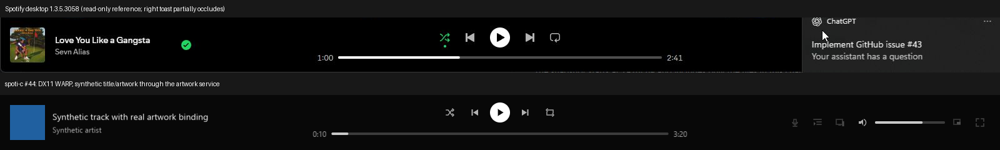
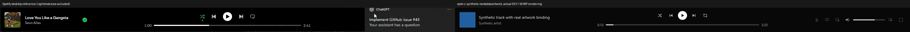
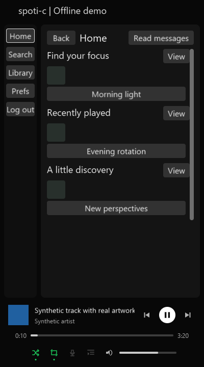

# Spotify desktop player bar (#44)

Evidence and implementation contract, recorded before implementation on 2026-10-20.

REA MCP parsed `dwp-now-playing-bar.js` and `xpui-pip-mini-player.js` in the
extracted XPUI tree, SHA-256
`8fe63d71062b5b05fc69d319c4856d99431b4e5f404f0ffe641ce6c827712728`.
Parent evidence:
`ev_8cfe785e95bba5e1785f4b307754d7e9c7c87d3e71f204aad9e84d3fd55360ee`.
Two scripts / 96832 bytes parsed without failures. Other 269 sources and dynamic
relationships remain unknown; bounded semantic coverage is partial. Static
analysis did not execute Spotify or establish exact runtime interaction timing.
The extracted manifest pins 1.3.4.258; the separately observed installed desktop
reference is 1.3.5.3058. Neither is asserted to be the latest version.

The observed desktop reference groups artwork/title/artist at the left, transport
over elapsed/seek/duration in the center, and secondary controls/mute/volume at
the right. Play/pause is a white circular primary action; secondary icons use
quiet backgrounds and visible hover/focus/disabled states. The previous native
two-row text-button layout does not match that structure.

Implementation details, capability boundaries and measured checks follow below.

## Implementation contract

- Use a bounded three-part bar: 56-DIP cover and 14/12-DIP metadata at the left,
  a centered 32-DIP primary transport above 4-DIP seek rail and separate 12-DIP
  elapsed/duration labels, and 16-DIP secondary icons with 32-DIP pointer targets.
  Base height is 88 DIPs. Compact windows retain transport, seek and volume in
  an explicit bounded 120-DIP composition; they do not squeeze overlapping rows.
  The narrow adaptation is a native policy until a matching desktop reference
  at that width exists. Main content keeps its existing player-bar boundary.
- Icons are original procedural vector shapes rendered by the existing DX11
  instanced pixel shader; no new font, image dependency or per-frame allocation.
  Keyboard focus and pointer hover show text labels, including unavailable
  control reasons. Reduced motion requires no animation because states redraw
  only on existing input/state events.
- The existing Player owner supports play/pause, previous/next, seek, app volume,
  shuffle and repeat. Publish repeat/shuffle and finite queue position in the
  immutable snapshot instead of predicting successful commands in the UI.
  Lyrics uses the existing route. Queue inspection requires an existing queue
  snapshot binding. Device selection, miniplayer and fullscreen are unavailable
  in this client and must say why when focused/activated.
- Track metadata is keyed by compact track ID, independent of navigation
  generations. Never display one track's title/art under another track ID.
  Preserve bounded copies for known catalog/playlist items. The existing media
  resolver may project Track.name, first Artist.name and Album cover identifiers
  from the already pinned proto/metadata.proto definitions. This adds no endpoint,
  header, persisted hash or guessed JSON schema. Record the actual artwork URL
  authority before introducing any identifier-to-URL formatting.
- Seek labels and fill use consumed frames. During buffering/starvation keep the
  last authoritative consumed position; no extrapolation or cosmetic progress.
  Drag preview never submits a seek until release. Cancel, track replacement,
  invalidation or an external seek cannot commit a stale gesture. Volume retains
  #38's acknowledgement tickets, remembered nonzero level and failure behavior.
- Metadata publication is a bounded owner-to-UI copy, outside layout and audio
  callbacks. Cover preparation uses the existing artwork cache; navigation may
  retire route artwork but must re-pin the current track cover. No route page is
  retained merely to display the player bar.

## Existing cover URL reference

The pinned ordinary source references independently define image ID formatting:
`ref/librespot/metadata/src/audio/item.rs:74` uses
`https://i.scdn.co/image/{file_id}`, and
`ref/cspot/cspot/src/TrackQueue.cpp:96` concatenates the same base with the
hex-encoded image ID. These are source observations, not executed native code.
The repository manifest pins librespot commit
`19959512c212cbc48a3ff64382fe204f52c659a7`. The UI's existing artwork fetcher
already handles unauthenticated HTTPS images. Use exactly a validated 20-byte
cover ID encoded as 40 lowercase hex characters; no auth headers or redirects.
This does not change a Spotify API request. Missing cover IDs remain explicit.

## Capability matrix

| Control | Binding / behavior | Unavailable state |
| --- | --- | --- |
| Play/pause, previous/next | Existing Player submission; snapshots acknowledge state | Sign-in, service, stopped/error reasons |
| Seek | Consumed frames; release-only commit; arrows five seconds, Home/End | Unknown duration or invalid timeline (except paused) |
| Volume/mute | Existing ticket receipts, continuous drag, remembered nonzero level | Sign-in or playback binding missing |
| Shuffle | Existing bounded Player queue shuffle | Same admission as transport |
| Repeat | Existing Player repeat enum; explicit labels cycle off → one → all → off | Same admission as transport |
| Lyrics | Existing lyrics route and catalog service; no new endpoint | Explains catalog/track dependency |
| Queue | Read-only finite owner queue, current marker and keyboard-accessible earlier/later pages | Explains missing queue service; uncached names say metadata pending |
| Devices | No device selection service bound to this shell | Focus/activation explains Connect dependency |
| Mini player/fullscreen | No supporting window service | Focus/activation explains missing window service; omitted at smaller widths |

The repeat order and deterministic shuffle seed are native client policies, not
claims about Spotify's runtime implementation. A further REA literal trace for
`repeat` returned no matches in the partial selected graph
(`ev_a6fa9c00124aca48d2dc71cf9a6653d66ca0f0489afd8cc923c32c09276ce139`);
this does not establish absence. No Spotify repeat-cycle runtime was changed to
infer its order. Unavailable buttons are dimmed but remain focusable for their
reason. Full tooltip text is retained by the existing Read messages transcript.

## Verification and remaining acceptance

On 2026-10-20, the isolated issue checkout passed the complete Debug/ASan command
`ctest --test-dir build --output-on-failure`: **54/54** tests, 63.62 seconds.
Strict-warning builds passed. New checks cover bounded UTF-8 metadata projection,
cover selection, owner handoff/eviction, all icon admissions, centered/narrow/DPI
geometry, queue paging, real Player mode/next/previous commands, metadata changes,
frozen buffering clocks, external generation changes and cancelled/stale seeks.
Existing allocation, gapless, scheduler, SMTC and volume ticket tests still pass.
App state is 257152 bytes, within the existing 256 KiB cap. New C modules remain
below 500 lines. No idle polling/render timer or release threshold was added.

Release was built with `ENABLE_ASAN=OFF`; the existing dependency audit passed
with **383 C translation units, six artifacts, zero failures**. `spotic.exe` is
**1,051,136 bytes**. App shell, media-source, renderer and SMTC Release tests pass.
The audit initially detected checkout CRLF conversion in three yyjson files;
restoring their exact pinned LF bytes passed without changing vendor content.
This source/import/size audit is separate from the complete #35 performance gate;
cold-start, live-account and physical-device criteria are not waived or certified.

`capture_player_bar` is an explicit manual DX11/WARP target. It records synthetic
metadata and artwork through the actual bounded services, asserts the displayed
cover pixel color, and emits nine normal/narrow/scaled/state captures. This
caught and fixed a Clay painter-order issue where a custom image's background
could cover the texture. The synthetic captures do **not** prove account-backed
artwork or physical GPU/WASAPI behavior.

The reference image is a read-only Spotify 1.3.5.3058 capture. A desktop
notification occludes its rightmost area; no hidden pixels were reconstructed.
The captured labels and controls were also observed through accessibility. A
later read-only observation showed playback on a phone and external track
changes; it is not evidence that this native client's media controls interoperate
with that device. No Spotify playback control was operated in these captures.

Remaining acceptance prevents closing #44:

- The explicitly opted-in account/WASAPI Release check is awaiting consent to
  start playback. `ENABLE_LIVE_HEADLESS_TEST=ON` builds `test_player_bar_live` in
  Release. It requires `SPOTIC_PLAYER_BAR_LIVE=1` plus private
  `SPOTIC_HEADLESS_CREDENTIALS`, `SPOTIC_HEADLESS_CACHE`, `SPOTIC_MEDIA_TRACK`,
  `SPOTIC_MEDIA_TRACK_NEXT`, `SPOTIC_MEDIA_COUNTRY` and `SPOTIC_MEDIA_CATALOGUE`.
  Without these it returns CTest skip 77. The harness verifies bar commands,
  pause freeze, acknowledged seek/volume/mute, next/previous metadata, modes,
  queue and an owner-originated pause, and always closes the runtime on failure.
  Its safe skip was verified; a skip is not a successful live check.
- The optional visible Release `app_volume_native` attempt failed because
  Windows denied foreground activation (`SetForegroundWindow`). Checking actual
  foreground ownership also failed. The original test remains intact. Its two
  failed child processes were identified by exact executable path and retired.
- Account-backed cover download/GPU and native desktop control acceptance still
  need successful runs. Prerequisite #41's full measured visual foundation and
  #42's shell integration remain open. The committed desktop host still binds
  offline demonstration services; fixture routes do not establish production
  account-backed GUI acceptance.
