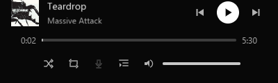
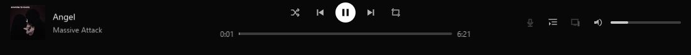
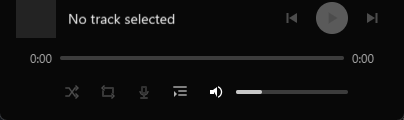

# Issue #44 approved live acceptance

The user explicitly approved the saved-account Release playback/control and
desktop/GPU checks on 2026-10-20. Account values and signed audio URLs are never
included in these records. Playback uses two public track identifiers selected
from Spotify's public song pages, rather than a personal playlist.

## Startup observations and policy, before compatibility changes

The first Release run failed before playback: the sink opened (`AUDIO_OK`) but
`player_create` returned `PLAYER_INVALID`. WASAPI initialization had created a
USER32 queue on the dedicated decode owner. The existing `IsGUIThread(FALSE)`
guard consequently rejected that background owner. Explicit thread-local owner
registration at network/decode/worker entry distinguishes those threads from
actual UI owners; a regression creates a USER32 queue and checks both roles and
thread-local isolation. The UI restriction remains in place on UI threads.

The next run reached token authorization and failed `TOKEN_MALFORMED`. The
existing protobuf decoder reported only these non-secret grant fields:

- `expires_after_seconds = 1216800`
- `refresh_after_seconds = 1209600`

The local one-day cap rejected this client grant. The existing pinned schema and
native request evidence are in `auth-tokens.md`; no endpoint, headers, request
shape or credential authority changes. Adopt a finite 31-day client-token cap,
retain the one-day Login5 bearer cap and `0 < refresh <= expiry`, and test both
exact bounds and transactional rejection. This is local lifetime policy, not a
claim that the server always grants those lifetimes or that 31 days is its limit.

REA inspected the sanitized public-field projection before that policy change:
`ev_afe908723b2f7c05159b0eb2c4196d27f20144f53a44722380af8da8d92331f8`.
SHA-256: `bb499485d6ba73e3d1b1c0f0f10b5241f852ffc05476a4d31af31feb8da8e719`.
Full retained evidence is `now-playing-live-rea.json`. Its extension fields are
diagnostic observations from this client's decoder. It is **not an original
wire capture**: bodies, headers, credentials and binary bytes were omitted;
timestamp is projection creation time, timing fields are unmeasured placeholders,
and status 200 is derived from the existing `token_poll` success admission path.
REA preserves these producer facts with runtime attribution unknown. It did not
replay a request or independently authenticate that projection's execution.

Playback/control and GPU outcomes are recorded below after the compatibility checks.

The next response authenticated successfully but the decoder rejected provider
status **200** with `MEDIA_HTTP_ERROR`. Before changing admission, the native
diagnostic recorded the decoded status only. REA retained that separate metadata
observation in `now-playing-metadata-live-rea.json`; it is explicitly separate
from the client-token HAR record, and has no metadata URL, headers or body.
Admit provider status 200 along with the protobuf's default 0, while continuing
to reject other statuses. No request or endpoint changes. Independent envelope
fixtures test 0/200 success, non-success rejection and duplicate/truncated fields.

Playback then reached the consumed-frame clock and metadata handoff, and pause
froze correctly. Seek was rejected because progressive decoding had not reached
the final Ogg granule, so the Player snapshot's duration was zero. The existing
verified Track.duration field is already decoded as milliseconds. Carry it as
an optional source duration hint to the decode owner, convert using its actual
output rate, and publish it until the decoder supplies an exact sample length.
The hint neither advances position nor ends playback. A blocked-input test checks
early publication, then EOF must replace the hint with the actual frame count.

Cold seek subsequently rejected `AUDIO_TRUNCATED`: a CRC-validated final Ogg page
ended at byte 13,676,959, while the logical decrypted source contained 13,676,961
bytes. The two following bytes were observed as `00 00`. REA preserves this
diagnostic projection in `now-playing-tail-live-rea.json`, under the same limited
producer authority as above. REA's native Windows PTY capture is unavailable
because it cannot verify descendant cleanup; the ordinary acceptance runner
collected the diagnostics. No source audio is checked in.

Introduce an explicit source opt-in for up to 15 zero bytes after a fully
validated final Ogg page. This small finite allowance is a local compatibility
policy; one observed two-byte tail does not prove a Spotify-wide padding rule.
Generic decoder callers remain strict by default. Both linear decode and cold
seek must validate every allowed tail byte before trimming the logical end;
nonzero tails, excessive tails, invalid CRCs and missing end pages still fail.
The final Ogg granule remains the sole authority for exact sample length. Test
linear and cold seek against independent PCM, including strict/invalid tails.

The network owner also retained completed range reservations when cancelling a
source. Cancellation sets request results but does not consume their fixed table
slots. Explicitly consume prefix/payload reservations before source-slot reuse.
A single-runtime regression performs 24 load/prefetch/paused-seek/stop cycles,
exceeding the finite request table capacity, and requires balanced shutdown.
This is local ownership cleanup, not a change to Spotify's wire protocol.

## Accepted Release checks

The opted-in Release account/WASAPI check passed on 2026-10-20. The initial
control-only run took 5.99 seconds. The subsequent control plus hardware-DX11
artwork run took **6.24 seconds** and observed:

- Actual consumed audio frames, resolved title/artist/cover, and a frozen paused
  clock. A paused seek changed generation and acknowledged the exact target.
- Volume 25%, mute and 25% restore, resume, next/previous metadata handoff,
  shuffle, repeat-one, finite queue inspection, route persistence, and a final
  owner-originated pause. Runtime shutdown and handle accounting balanced.
- Downloaded cover images through the existing HTTPS worker and bounded texture
  cache. Offscreen DX11 used the physical adapter with WARP and fallback disabled.
  Normal/narrow/current-next captures resolved valid textures and asserted more
  than 100 varied cover pixels, preventing a uniform placeholder from passing.
  The first track uploaded once; changing tracks produced the second upload.

The two input tracks are public Spotify song pages:
[Teardrop](https://open.spotify.com/track/67Hna13dNDkZvBpTXRIaOJ) and
[Angel](https://open.spotify.com/track/6yOL0M0UiCXC5SRlfRHg1U).
Private credentials, account IDs, tokens, encrypted audio and signed URLs remain
outside the repository. The test requires `SPOTIC_PLAYER_BAR_LIVE=1` plus the
existing private credential/cache, two track URI, country and catalogue inputs;
missing inputs still return skip 77. A skip is not acceptance.

The visible Release `app_volume_native` check passed in **6.65 seconds** at
96 DPI with 1084x681 and 404x681 client areas. It exercised real pointer click
and continuous drag, mute/restore, Home/End/arrows, Settings navigation, compact
controls and persisted 24% volume across process restart. This host uses the
explicit offline demo, so it independently validates desktop input/presentation,
not account-backed catalog routes. Its synthetic audio is separate from the
account/WASAPI run above.

Windows initially denied the test's foreground request; the test now waits up
to 15 seconds for **actual** foreground ownership and still fails if it is not
obtained. Navigation-key injection now supplies mapped scan codes and extended
key flags. Computer Use independently verified that Home worked on the focused
slider before correcting that test input. No product keyboard assertion was
removed. Final runs acquired foreground and completed without intervention.

The native HWND/WinRT SMTC smoke check also passed: metadata replacement,
playing/paused status, audible timeline, callback detachment and COM teardown.
Only the Windows inbox `System32/msvcp_win.dll` was observed; application C++
redistributable runtimes remained absent. Global flyout/listener and physical
media-key observation remain manual, as already stated by that separate test.

Two full ASan attempts failed only the idle-window assertion, including one
after native checks finished. Temporary diagnostics showed repeated Win32
`QS_SENDMESSAGE` wakeups (`0x00400040`), zero extra frames and zero timeouts.
Releasing the computer-use inspection session removed those wakeups and the idle
test passed unchanged. This supports inspection traffic as the cause; no idle
assertion or scheduler behavior was relaxed. Temporary diagnostics were removed.
The final full-suite result, artifact hashes and retained capture hashes are
recorded in `now-playing-live-validation.json`.

These checks do not certify the independent #35 cold-start/residency/idle CPU
release gate, the full #41 visual foundation, or #42 account-backed shell routes.
Those issues and thresholds remain unchanged. This issue validates the player
bar module and its real playback/artwork bindings, with independent desktop input
and native media-adapter checks.
